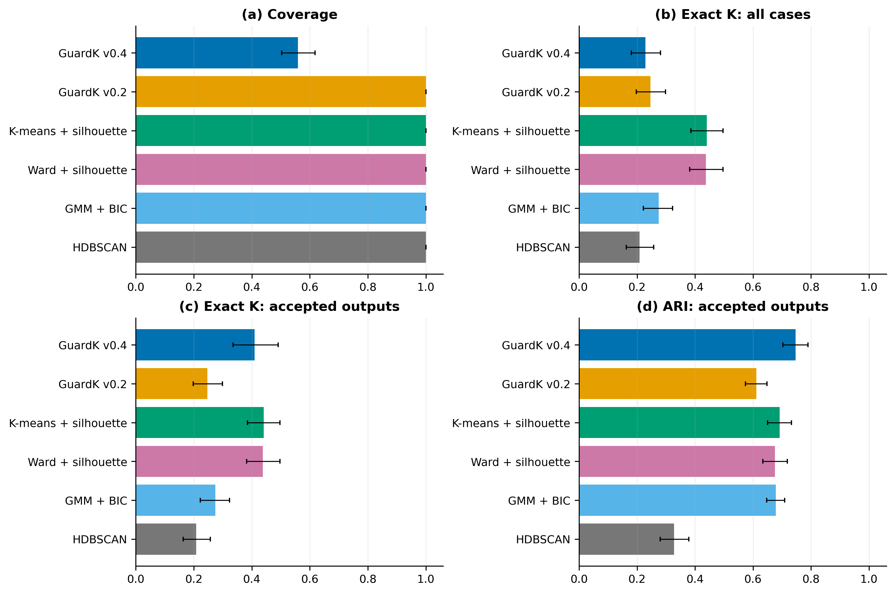
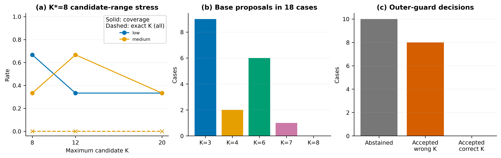

# GuardK

**Stability-Guided Prototype Clustering with Unknown Cardinality under Imbalance and Overlap**

Author: **Mojtaba Jahanian** ([ORCID](https://orcid.org/0009-0006-3241-5595)).

## Release scope

This repository contains the **recovered original GuardK v0.4 research implementation**, original experiment scripts, archived per-run confirmatory results, selected frozen protocol records, and figure-reproduction tools. Source was recovered from the G10B evidence export, not reconstructed from the manuscript. The two core modules match the G9 recorded SHA256 values; see `docs/provenance/FROZEN_SOURCE_VERIFICATION.json`.

The full confirmatory grid has not been rerun for this release. The archived environment snapshot, current smoke-test runtime and remaining limitations are documented in `docs/REPRODUCIBILITY.md`.

## Method in brief

GuardK builds candidate partitions by sequential prototype splitting, scores candidates using label-free stability and structural diagnostics, and selects a parsimonious near-best cardinality. An outer guard reruns the selector on five 80% subsamples and accepts the original partition or abstains. Reproducibility is not a correctness certificate.

## Reported confirmatory summary

| Quantity | GuardK v0.4 |
|---|---:|
| Cases | 288 |
| Accepted outputs | 161 (55.9%) |
| Exact cardinalities among accepted outputs | 66/161 (41.0%) |
| Exact cardinalities over all cases | 66/288 (22.9%) |
| Accepted mean ARI | 0.747 |
| Accepted mean NMI | 0.757 |

K-means + silhouette achieved 44.1% unconditional exact-cardinality recovery on the same grid. Accepted-only metrics and full-coverage metrics use different case sets. No universal superiority or clinical-validation claim is made.

In the post-freeze K*=8 stress block, the guard withheld 10/18 outputs but accepted eight incorrect cardinalities. The true K was eligible and near-best, while the parsimony rule favored a smaller candidate. These diagnostic results were not used to retune the frozen method.

## Selected result previews





## Contents

- `src/guardk/`: unchanged original implementation; use `GuardKPrototypeV04`.
- `experiments/original/`: original developmental and confirmatory launchers.
- `archived_results/`: original per-run and aggregate G7/G8/G9 and selected comparator outputs.
- `manifests/`, `environment/`: original hash/protocol records and environment snapshot.
- `evidence/`: final-method aggregate tables, selected protocol/lock records, and comparator summaries.
- `results_data/`: predecessor-stage derived results; **not GuardK confirmatory evidence**.
- `tables/`, `appendices/`: source tables and diagnostic descriptions used by the plotting program; these fragments are provenance, not a complete standalone manuscript.
- `scripts/generate_results_figures.py`: recreate the five G13 result figures from available summaries.
- `scripts/verify_evidence.py`: validate counts, subgroup aggregation, and recorded integrity hashes.
- `docs/`: method specification, evidence hierarchy, and limits of reproducibility.
- `SHA256SUMS`: integrity hashes for the preserved input files.

## Install and smoke-test the recovered implementation

```bash
python -m pip install -e .
python scripts/smoke_frozen_v04.py
```

The original smoke test checks label-free fit, deterministic repeated output, and easy-case recovery. It is not a new confirmatory experiment.

## Run the frozen confirmatory grid

```bash
python -m pip install -r requirements-experiments.txt
python scripts/run_frozen_g9.py --output runs/g9_reproduction
```

Choose a new output directory. This runs the original full grid, with only its historical output root relocated. It can take substantial time and was not rerun in preparing this release.

## Verify the supplied evidence

```bash
python scripts/verify_evidence.py
```

This standard-library check verifies the supplied summaries and hashes; `scripts/verify_confirmatory_runs.py` additionally recomputes aggregate metrics from archived per-run records. Neither check recomputes ARI/NMI from sample-level predictions or proves historical preregistration.

## Recreate summary figures

Use Python 3.10 or later in a virtual environment:

```bash
python -m venv .venv
# Activate .venv using the command appropriate to your operating system.
python -m pip install -r requirements-figures.txt
python scripts/generate_results_figures.py
```

Figures are written under `figures/results_g13/`. The plotting dependencies specify compatible lower bounds, not an exact experimental environment lock. G11 mean runtimes and memory are transcribed from published-precision manuscript tables; no missing per-seed distribution is reconstructed.

## Evidence hierarchy

1. G9: frozen-method 288-case confirmatory grid.
2. G7/G8 and modern-comparator blocks: real-data benchmark and controlled prevalence stress.
3. G11/G11B: post-freeze stress and failure explanation.
4. V3.2--V5.2 and locked predecessor cohorts: development history of earlier methods.

The earlier method was called AutoUOT-DC. Its stronger controlled and pan-cancer results are not performance estimates for final GuardK v0.4. The final GuardK core does not include optimal transport.

## Data and rights

Only derived benchmark/experimental summaries are included. No raw patient-level clinical records or source datasets are redistributed. Obtain datasets from their original sources and comply with their access and reuse terms. No general open-source license is granted by this preview; see `RIGHTS.md`.

## Citation

Use `CITATION.cff` to identify this software and evidence package. No journal DOI or public archive DOI has been assigned in these files. Update the citation metadata after publication or an archived release.
